# 第二阶段审核：Logo、导航和共享视觉样式

基线：`8f4d6c79c65fd17fa96062e48404bac31feaaeda`（已合并 PR #1 的 main）。
工作分支：`design/shared-brand-navigation`。本变更供 Draft PR 审核，未合并或发布。

## 实现

- 原样使用 `assets/cadlab-logo.jpg`（1500×234），应用到全部 15 页的页头和页脚。通过原始宽高、`height:auto` 和 `object-fit:contain` 保持完整比例，显示尺寸小于原图；没有重画、裁剪、覆盖或重编码原图。
- Motto & Logo 页内的历史 Logo 和说明原样保留；所有既有图片文件保持字节一致。
- 静态导航统一为 Home、CAD Lab、People、Publications、Research、News、Archive、Contact。保留原有 13 个下拉子页入口，跨目录路径正确；增加当前页/分类提示、跳过导航链接。
- 复用第一阶段导航逻辑并抽取为 `assets/navigation.js`，供全站使用。分类文字仍是原生页面链接，箭头按钮独立控制子菜单；支持触屏、桌面悬停、Enter、Space、方向键、Tab、Esc 和焦点恢复。移动导航断点仍为 900px。
- 901–1100px 使用两行桌面页头，避免新增导航入口挤压横向 Logo；更宽屏幕使用单行页头。
- 白色、深蓝和科技蓝；共享字体、1140px 最大内容宽度、标题、卡片、边框与间距；全部子页移除重复内联 CSS，使用 `assets/styles.css` 与 `assets/pages.css`。没有引入前端框架或构建依赖。
- 页头页脚以静态 HTML 输出，模板由 `tools/sync-layout.py` 单点维护。保留各页原有页脚来源说明。

## 原始资料保留检查

逐页比较基线与结果，15 页 `<main>` 内部 HTML **字节完全一致**，包括所有人名、履历、邮箱、电话、论文、项目状态、日期和原有内容链接。子页 Hero 标题区和内联 Articles 数据也字节一致。所有原有图片和 `assets/content.js` 字节一致。

没有删除原有文件，没有更改 Research 项目分类或状态，没有修改联系方式或人员记录。展示样式调整没有改动资料含义。

## 验证结果

Playwright 驱动系统 Chromium 154，在临时 loopback HTTP 服务上执行真实浏览器测试，测试基线与修复版本均来自本地代码。六个宽度分别为 375、430、768、900、1024、1440px，视口高度 1000px；900px 及以下启用触屏模拟。

| 页面 | 375 | 430 | 768 | 900 | 1024 | 1440 |
|---|---|---|---|---|---|---|
| Home | 通过 | 通过 | 通过 | 通过 | 通过 | 通过 |
| Introduction | 通过 | 通过 | 通过 | 通过 | 通过 | 通过 |
| Motto & Logo | 通过 | 通过 | 通过 | 通过 | 通过 | 通过 |
| Contact | 通过 | 通过 | 通过 | 通过 | 通过 | 通过 |
| Professor | 通过 | 通过 | 通过 | 通过 | 通过 | 通过 |
| Members | 通过 | 通过 | 通过 | 通过 | 通过 | 通过 |
| Alumni | 通过 | 通过 | 通过 | 通过 | 通过 | 通过 |
| International Papers | 通过 | 通过 | 通过 | 通过 | 通过 | 通过 |
| Korean Papers | 通过 | 通过 | 通过 | 通过 | 通过 | 通过 |
| Articles | 通过 | 通过 | 通过 | 通过 | 通过 | 通过 |
| Patents | 通过 | 通过 | 通过 | 通过 | 通过 | 通过 |
| Standards | 通过 | 通过 | 通过 | 通过 | 通过 | 通过 |
| Ongoing Projects | 通过 | 通过 | 通过 | 通过 | 通过 | 通过 |
| Closed Projects | 通过 | 通过 | 通过 | 通过 | 通过 | 通过 |
| Archive | 通过 | 通过 | 通过 | 通过 | 通过 | 通过 |

共 **90/90** 通过：Logo 加载与比例、默认导航状态、四组子菜单、展开状态同步、键盘导航、Esc、桌面悬停、横向溢出和子菜单边界。未发现 JavaScript 运行错误。

另检查 Professor 真实页面跳转、从子页进入首页 News 锚点、900↔1024px 状态重置。基线与结果的浏览器正文文本一致。

静态检查：15 页标签栈与唯一 ID；474 个本地链接、资源路径及锚点；内容字节一致性；模板重复运行无变化；JavaScript 语法和 `git diff --check`，全部通过。机器可读结果见 [browser-results.json](browser-results.json)。复现命令见仓库 README，测试脚本保存在 `tools/`。

边界：未执行实体设备、Safari 或 Firefox 测试；外部 Google Maps iframe 在本地测试中被空白响应替代，不代表验证了地图服务或步行路线。测试服务器对缺省 favicon 请求返回 204，不将仓库原有 favicon 缺失当作脚本错误。

## 前后截图

均为浏览器原始首屏截图，1440×1000 或 375×1000。长页面的后续内容不包含在首屏图中，但完整正文保留已通过代码和 DOM 文本检查。Contact 截图中的地图区域为空白属于上述本地测试替代。

| 页面 / 宽度 | 修改前 | 修改后 |
|---|---|---|
| Home / 1440 | 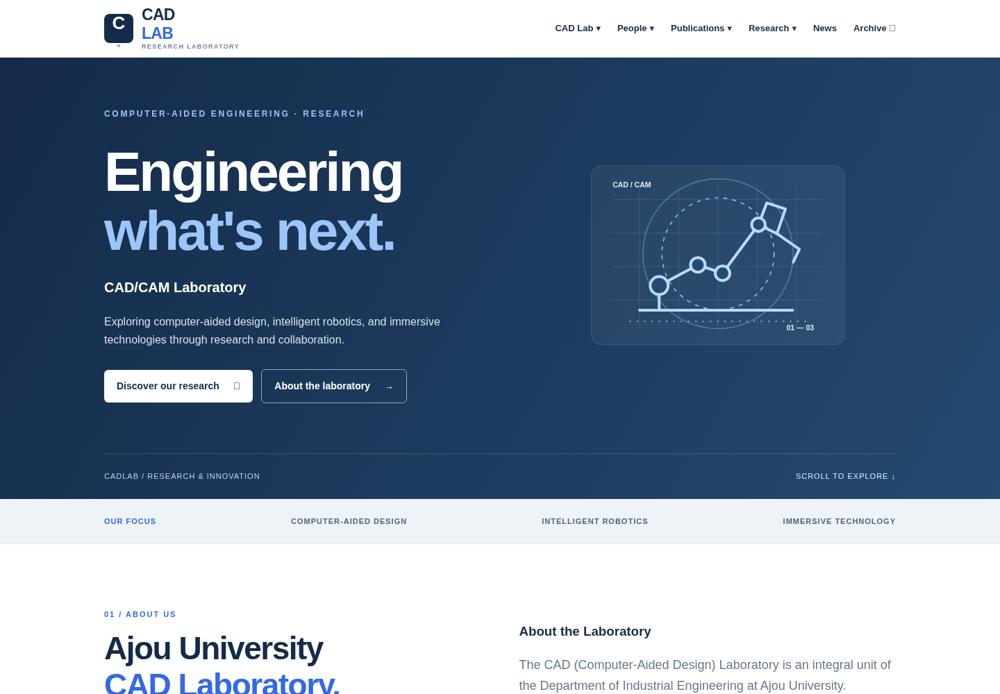 | 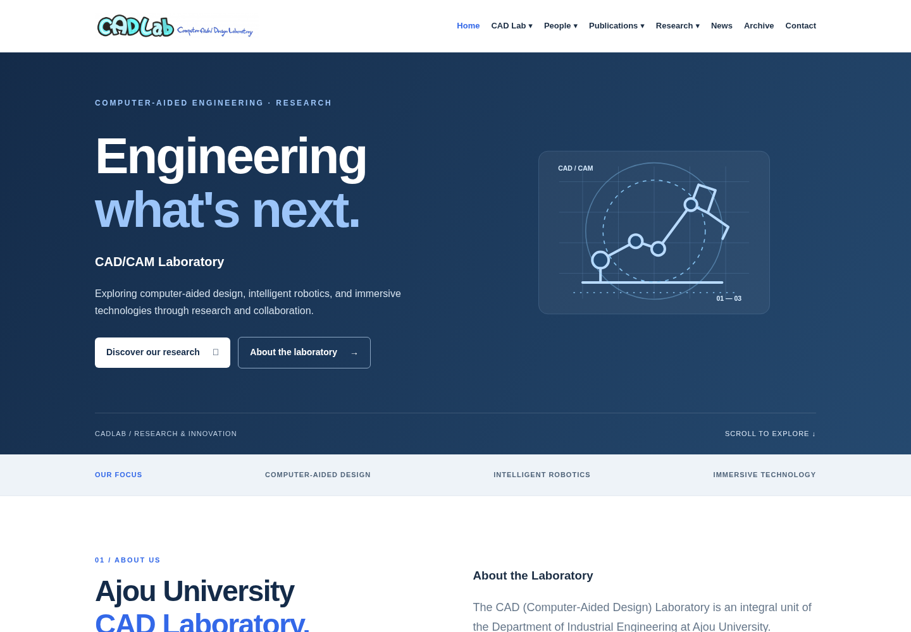 |
| Professor / 1440 | 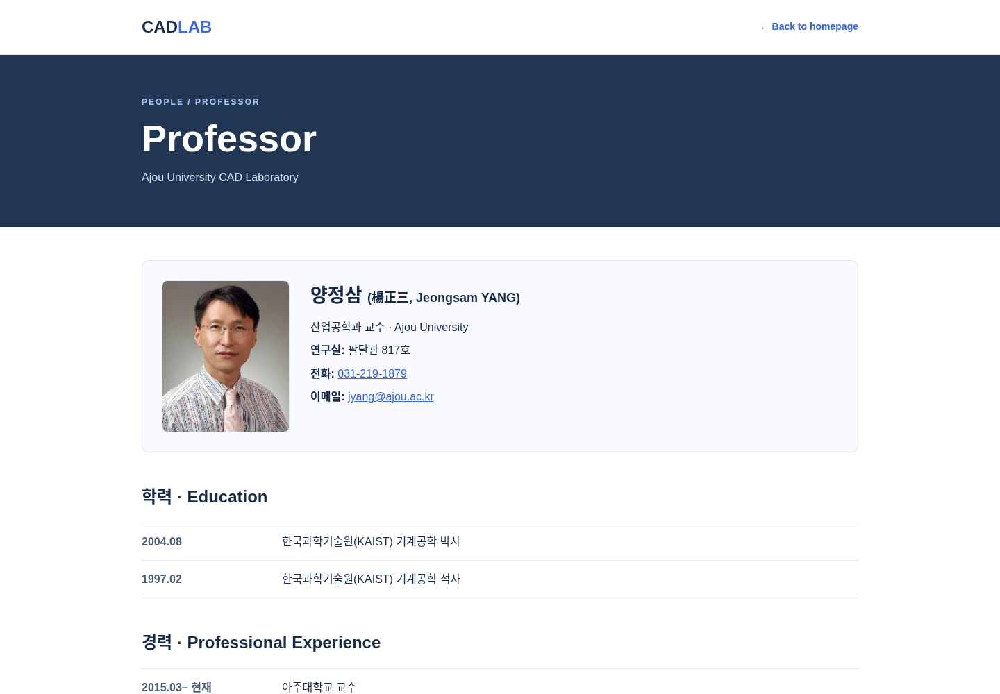 | 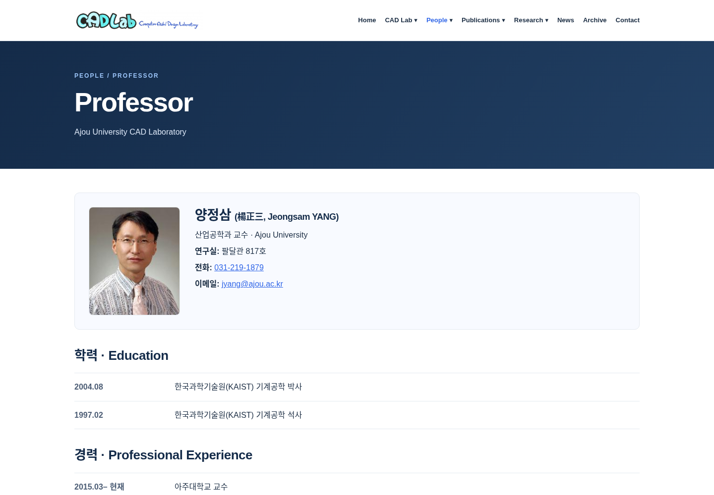 |
| Alumni / 1440 | 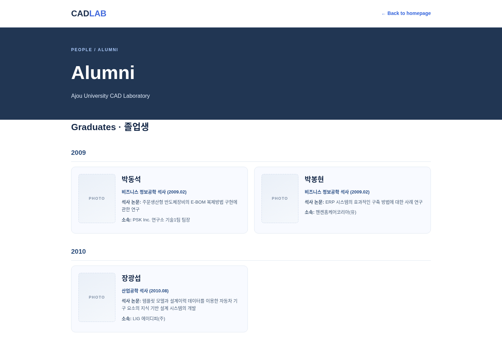 | 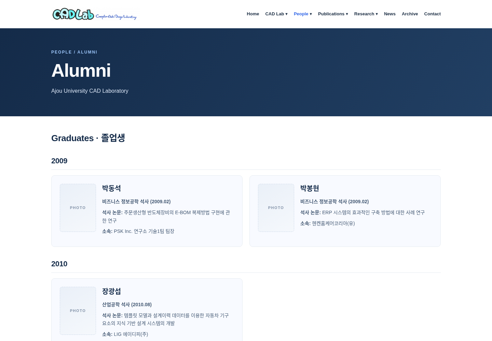 |
| Publications / 1440 | 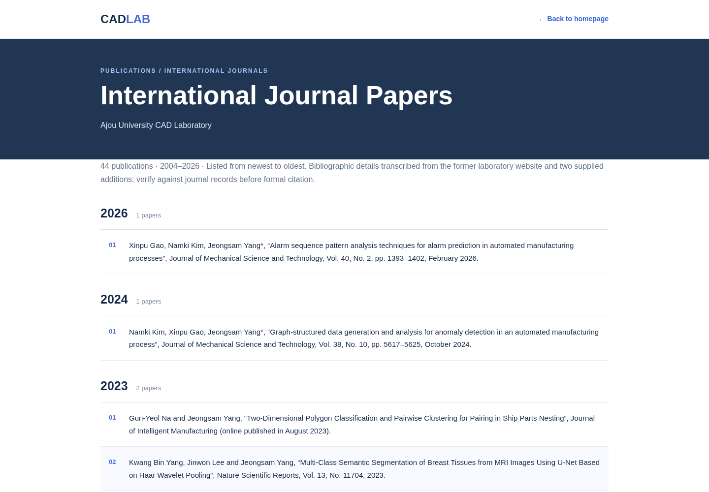 | 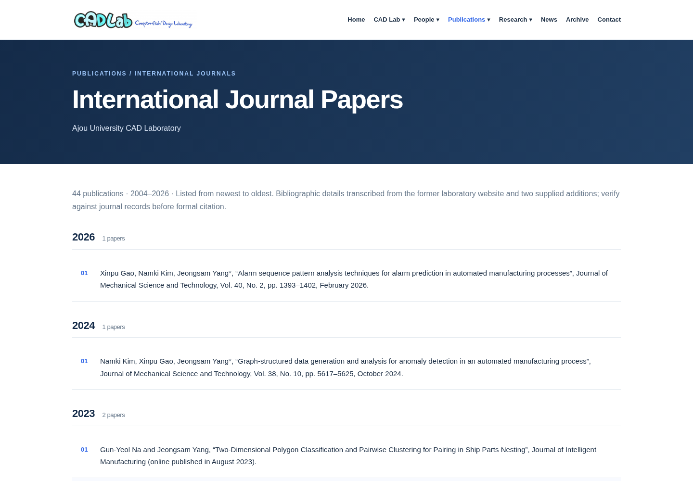 |
| Research / 1440 | 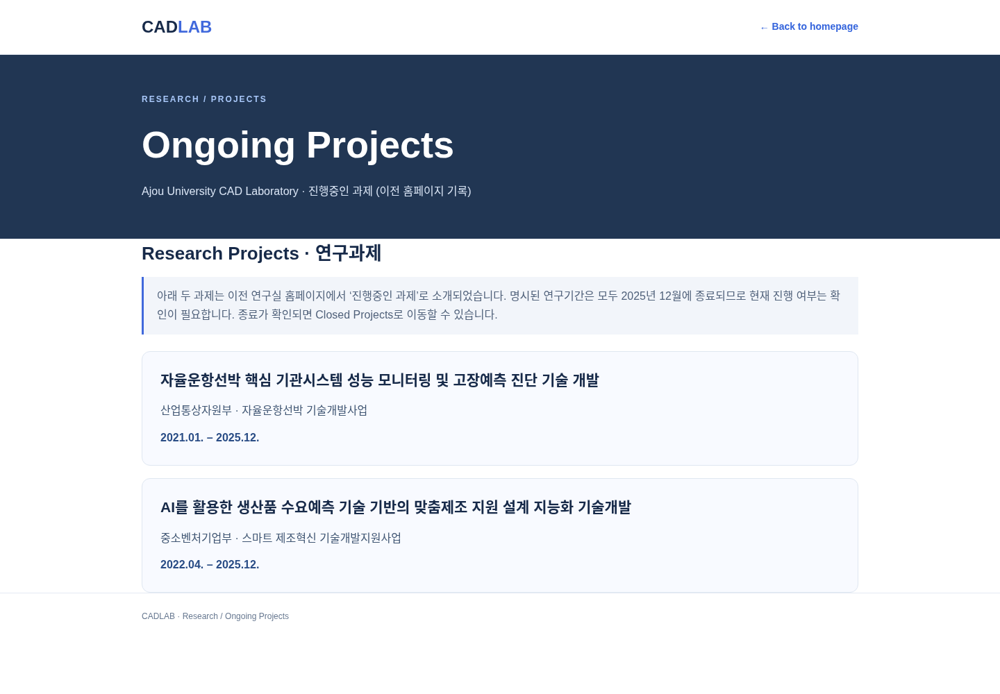 | 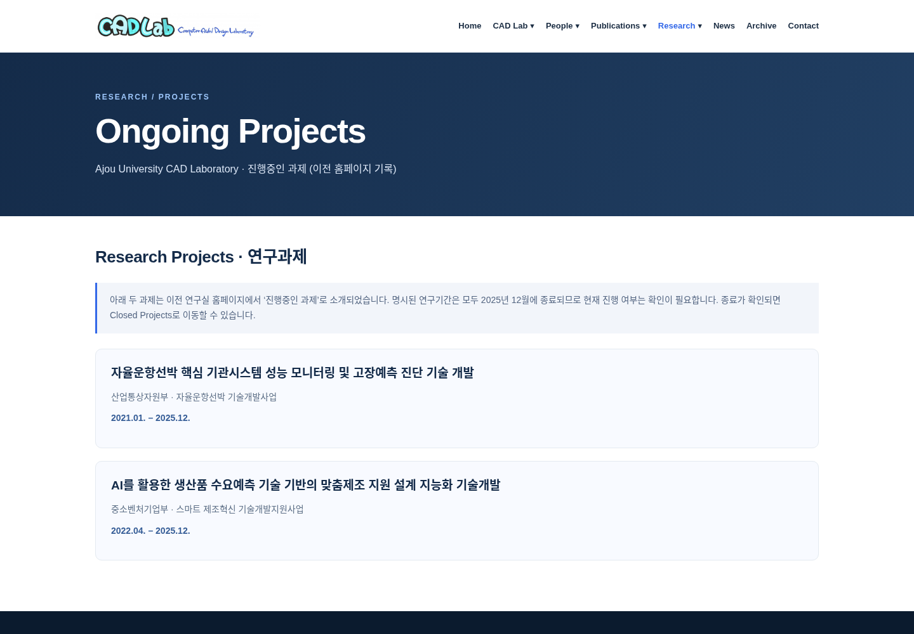 |
| Contact / 1440 | 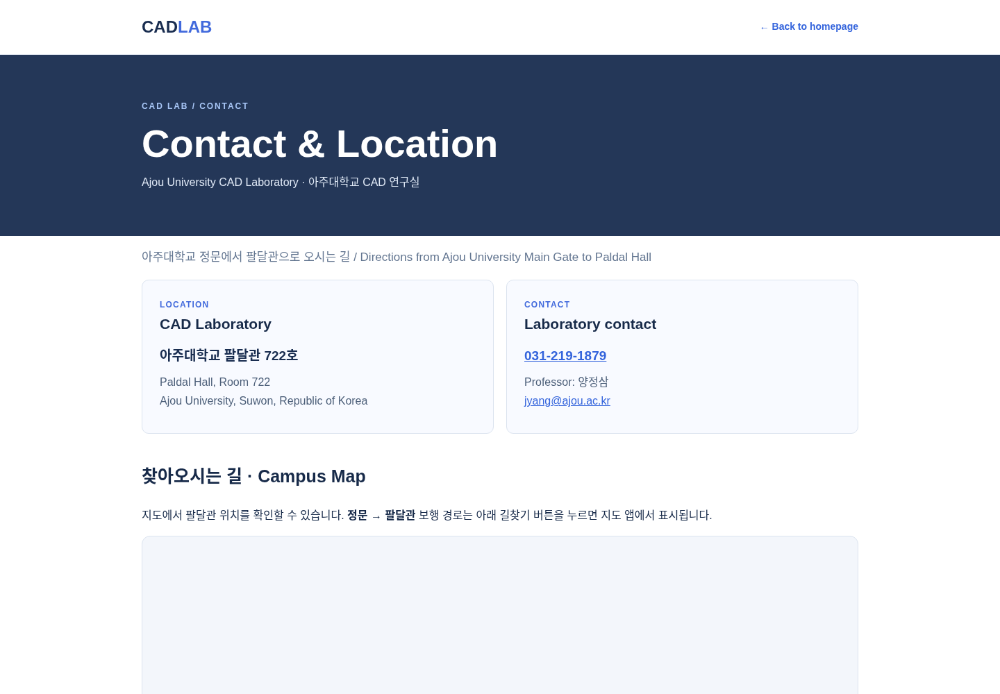 | 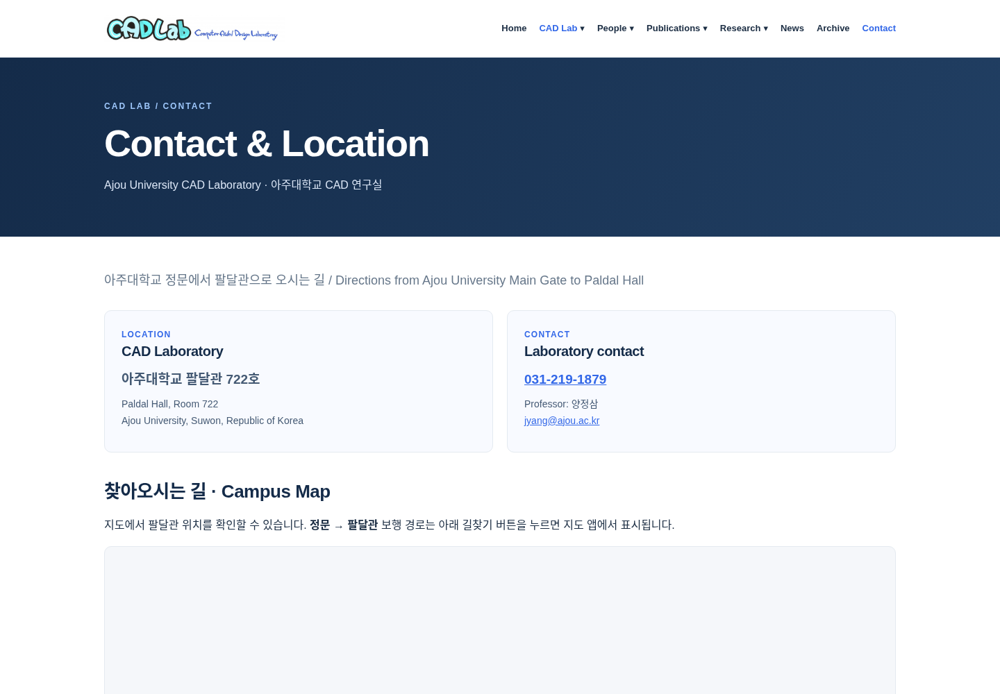 |
| Home / 375 | 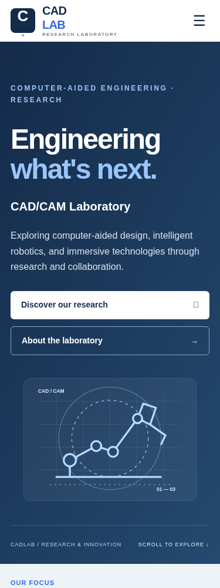 | 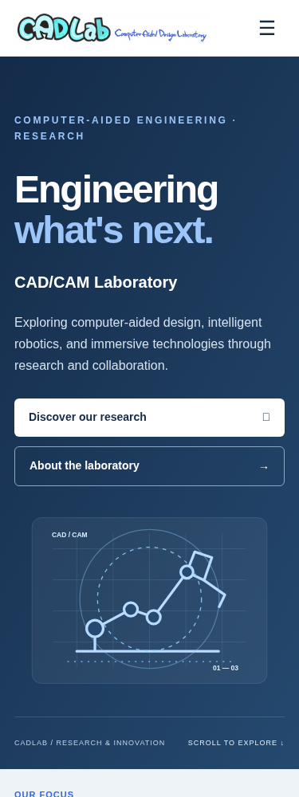 |
| Professor / 375 | 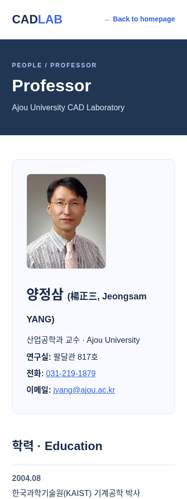 | 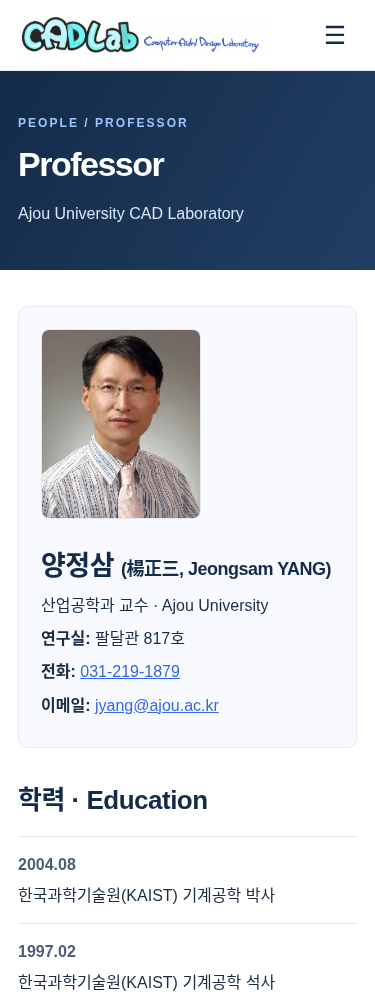 |

截图与本报告保存在 `.github/review/phase2/`，作为代码审核资料；没有新增网站 HTML 页面。

## 文件清单

修改的页面：

- `index.html`
- `archive/index.html`
- `lab/introduction.html`
- `lab/motto.html`
- `lab/contact.html`
- `people/professor.html`
- `people/members.html`
- `people/alumni.html`
- `publications/international.html`
- `publications/korean.html`
- `publications/articles.html`
- `publications/patents.html`
- `publications/standards.html`
- `research/ongoing.html`
- `research/completed.html`

共享样式/脚本与维护文件：

- `assets/styles.css`：共享基础样式、首页和导航布局。
- `assets/pages.css`（新增）：子页共享内容样式。
- `assets/navigation.js`（新增）：提取并复用第一阶段导航交互。
- `assets/site.js`：仅保留首页内容渲染。
- `tools/sync-layout.py`（新增）：统一静态页头、页脚模板。
- `tools/check-site.py`（新增）：内容保留、链接、HTML 结构及模板幂等检查。
- `tools/check-browser.cjs`（新增）：全站六尺寸浏览器回归与截图。
- `README.md`：补充共享布局维护与验证步骤。
- `.github/review/phase2/REPORT.md`、`browser-results.json` 和上述 16 张 PNG：审核交付资料。
