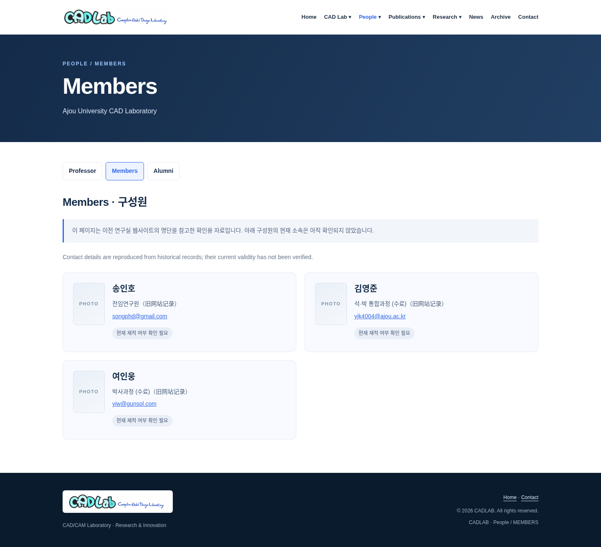
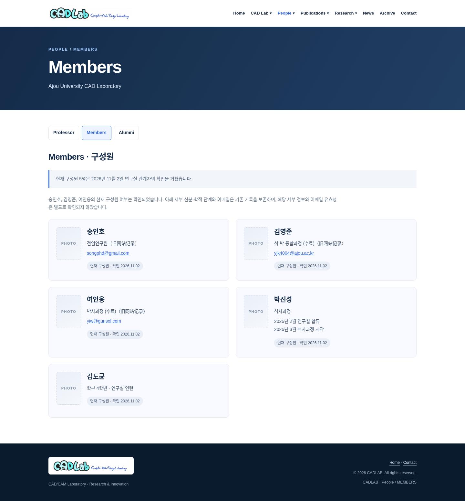
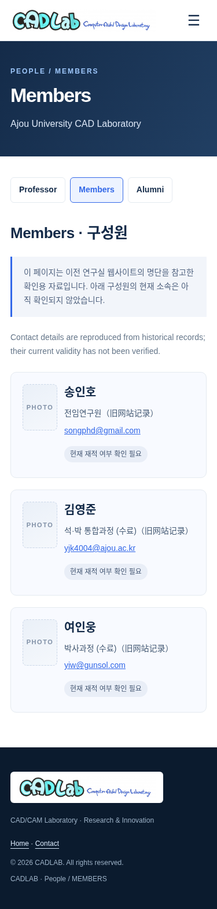
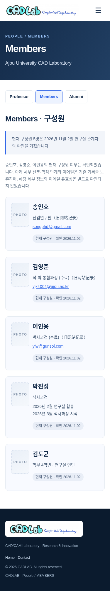

# CADLAB 第三阶段最终资料更新审核报告

## 版本与确认范围

- PR 整体基线：`61dd7e9`，包含第二阶段 PR #2。
- 本轮更新前：`34afb7f`；本轮截图以这个现有 Draft PR #3 版本为“修改前”。
- 分支继续使用 `content/phase3-information`，没有新建 PR；本轮仅更新 Draft PR #3。
- 来源：用户转达的 **2026 年 11 月 2 日实验室人员确认**。这不是独立出版商、专利机关或标准机构核验。

## 已应用的确认结果

### Professor

양정삼（Jeongsam Yang）仍在 Ajou University 任职；팔달관 817호、031-219-1879、jyang@ajou.ac.kr 已确认。删除与这些字段相矛盾的待核实提示；历史兼职、委员会任期和既往经历原文保留，不扩大为“目前均有效”。

### Members

当前 5 名成员：송인호、김영준、여인웅、박진성、김도균。原三人的身份与联系方式原文字段不变，确认其仍为成员，但没有把具体学籍阶段或邮箱有效性一并标为已核实。

박진성显示 석사과정、2026 年 2 月加入、2026 年 3 月开始硕士课程，不推算当前学期。김도균显示 학부 4학년 · 연구실 인턴，不增加未经提供的邮箱、电话或入学时间。五人均有相同尺寸设计的 PHOTO 占位，可后续用本人授权真实照片直接替换；没有生成或搜索人物照片。

### Alumni

全部 27 张卡片、学位、毕业年月、原单位及博士/硕士学位论文题目完整保留。毕业和现职单位确认限定于 2026-11-02，说明未来可能变动；保留年份及月份倒序、同月稳定顺序和全部照片区域。

### Research

| 项目 | 当前页 | 确认状态 | 实际日期与原研究期限 |
|---|---|---|---|
| P001 | Closed | 正式结项 | 实际结束 2025.12；原期限原文保留 |
| P002 | Ongoing | 仍在进行或延期 | 原计划 2022.04–2025.12；实际结束年月未知，没有新造期限 |
| P003–P026 | Closed | 全部正式结项 | 原名称、资助机构、研究期限保留；实际结项年月未提供，不拿原期限代替 |
| P027 | Closed | 正式结项 | 资助机构、实际开始及实际结束年月未知，明确提示 |

最终为 **27 个唯一项目，Ongoing 1 个、Closed 26 个**。P001 从 Ongoing 移除重复展示，P002 从 Closed 移除重复展示，其余不丢失。项目卡片以唯一 ID 标识，原研究期限与实际状态/实际结束字段分开。Closed 的年份分组沿用原记录研究期限的结束年份，不表示已确认的实际结项年份。

历史 29 次展示及每处原有资助机构/期限原文均保存在 [project-register.json](../../maintenance/phase3/project-register.json) 的 `historical_occurrences`，并保留原始卡片快照，不改写历史备份。

### Publications

44 国际期刊、29 韩国期刊、11 Articles、7 专利/软件版权、6 标准，共 **97 条**，逐条原文比较不变。删除“所有书目信息尚待核实”的笼统提示；保留分类、年份导航和仅有年份时的原精度，不补 DOI、月份、链接或引用次数。

原学位论文仍留在人员卡片，不误算为期刊成果。专利法律状态、官方登记现状与标准现行有效性没有单独确认，仍保留该范围的提示；不以实验室确认冒充官方核验。

### 首页和设计

首页 People / Alumni / Research 摘要与上述确认同步，移除旧的全局待核实或重复项目提示。原简介、研究方向、新闻和插画不变；15 页页头页脚、共享导航脚本、正式 Logo 及历史 Logo 不变。沿用白色、深蓝与科技蓝，无新前端框架。

## 维护记录和隐私处理

公开 GitHub 的 `.github` 并不私有。内部编辑说明文件在删除当前副本前，已保存仓库外受限临时副本，并创建、验证完整 Git bundle；备份目录权限 0700、文件 0600。没有把唯一副本直接删除，没有向外部存储擅自上传。

一张旧审核截图曾包含内部编辑说明，本轮已用更新前 `34afb7f` 的截图替换；新公开报告不重述内部内容。这里的移除只指 **PR #3 当前分支树**，main 和正式网站尚未随 Draft 更新。旧提交、PR 差异、缓存或已有副本仍可能访问旧内容，不能宣称已全面私密化。

用户已选择先提供私有保存方案、稍后指定位置。建议负责人指定学校受限团队盘、仅授权成员可读的私有文档库或加密离线存储，再校验备份及访问名单。临时执行环境不是长期保管库。若以后需要处理历史暴露，应另行授权协调；本次未重写历史、未强推。

## 验证结果

系统 Chromium + Playwright 真实本地浏览器检查：15 页 × 375、430、768、900、1024、1440px，**90/90 通过**；900px 及以下启用触屏模拟。

- 检查 Logo、汉堡默认状态、触屏/键盘菜单、Esc 与焦点恢复、跨页链接、年份导航、页面及下拉横向边界；未发现 JavaScript 运行错误。
- 原三位成员的角色/邮箱字段逐项不变，新两人和五个照片区齐全；27 张校友卡片原文不变；97 条成果 li/article 原文不变。
- 逐页核对项目 1/26 分布、27 个唯一 ID、所有原项目核心字段与历史 29 次展示；仅 P001 具有用户明确给出的实际结束年月。
- 补测首页全部 10 个详情链接实际跳转，关闭 JavaScript 后 Articles 的 11 条和年份导航，六种宽度的最终项目标签及年份标题可见性。
- 五个照片区尺寸一致；补充 375/1440px Members 整页图，便于核对全部 5 人。
- 静态 HTML 结构、唯一 ID、585 个站内链接/资源/锚点、JS 语法、原图及共享导航完整性、文档链接和 git diff --check 均通过。

机器结果：[全站浏览器](browser-results.json) · [补充检查](extra-results.json) · [记录与静态守护](static-results.json)。可复现命令见根 README。

边界：未测试实体设备、Safari、Firefox；全站测试中的外部 Google Maps iframe 使用本地替代，不代表地图服务核验；favicon 请求由测试服务器返回 204。截图来自本地分支，不代表已发布。

## 本轮修改前后截图

下列普通截图为 1000px 高视口；首页截图定位到对应内容区。`members-full` 是整页图。所有“修改前”均来自 `34afb7f`，以避免沿用含内部编辑说明的早期截图。

| 页面 / 位置 / 宽度 | 修改前 | 修改后 |
|---|---|---|
| alumni-1440 |  |  |
| alumni-375 |  |  |
| articles-1440 |  |  |
| completed-1440 |  |  |
| home-entries-1440 |  |  |
| home-projects-1440 |  |  |
| home-publications-1440 |  |  |
| international-1440 |  |  |
| korean-1440 |  |  |
| members-1440 |  |  |
| members-375 |  |  |
| members-full-1440 |  |  |
| members-full-375 |  |  |
| ongoing-1440 |  |  |
| professor-1440 |  |  |
| professor-375 |  |  |

## 仍需人工决定的事项

- 为内部备份指定长期私有存储位置；若需历史或缓存处理，另行决定及授权。
- 原三位成员的详细学籍阶段、邮箱有效性及教授其他历史兼职/委员会任期，尚未单独确认。
- P002 的具体延期安排及实际结束年月，P003–P026 的实际结项年月，P027 的资助机构及实际起止年月。
- 若要展示专利当前法律状态或标准当前有效性，需要单独官方依据。

完整确认范围见 [确认结果与剩余事项](../../maintenance/phase3/PHASE3-VERIFICATION.md)，私有保存方案见 [维护说明](../../maintenance/phase3/README.md)。

## 本轮实际修改文件及原因

下表相对 `34afb7f`，列出本轮每个实际修改文件；不是整份 PR 相对 main 的累计清单。

| 文件 | 原因 |
|---|---|
| `.github/maintenance/phase3/PHASE3-VERIFICATION.md` | 更新必要确认摘要、剩余事项和私有保存方案 |
| `.github/maintenance/phase3/README.md` | 更新必要确认摘要、剩余事项和私有保存方案 |
| `.github/maintenance/phase3/member-editorial-history.md` | 删除当前公开树副本；删除前已保存受限临时副本与完整Git bundle，不重述内容 |
| `.github/maintenance/phase3/project-register.json` | 记录确认状态、当前归属和实际日期；完整保留历史29次展示 |
| `.github/maintenance/phase3/publication-audit.json` | 更新97条内容确认来源及日期，不将日期精度或法律状态扩大确认 |
| `.github/review/phase3/REPORT.md` | 更新中文审核报告、确认范围和本轮逐文件说明 |
| `.github/review/phase3/browser-results.json` | 更新确认版机器验证结果 |
| `.github/review/phase3/extra-results.json` | 更新确认版机器验证结果 |
| `.github/review/phase3/screenshots/alumni-1440-after.png` | 使用本轮确认前/后的浏览器截图；替换过期或含内部说明的旧版本，整页图展示五人 |
| `.github/review/phase3/screenshots/alumni-1440-before.png` | 使用本轮确认前/后的浏览器截图；替换过期或含内部说明的旧版本，整页图展示五人 |
| `.github/review/phase3/screenshots/alumni-375-after.png` | 使用本轮确认前/后的浏览器截图；替换过期或含内部说明的旧版本，整页图展示五人 |
| `.github/review/phase3/screenshots/alumni-375-before.png` | 使用本轮确认前/后的浏览器截图；替换过期或含内部说明的旧版本，整页图展示五人 |
| `.github/review/phase3/screenshots/articles-1440-after.png` | 使用本轮确认前/后的浏览器截图；替换过期或含内部说明的旧版本，整页图展示五人 |
| `.github/review/phase3/screenshots/articles-1440-before.png` | 使用本轮确认前/后的浏览器截图；替换过期或含内部说明的旧版本，整页图展示五人 |
| `.github/review/phase3/screenshots/completed-1440-after.png` | 使用本轮确认前/后的浏览器截图；替换过期或含内部说明的旧版本，整页图展示五人 |
| `.github/review/phase3/screenshots/completed-1440-before.png` | 使用本轮确认前/后的浏览器截图；替换过期或含内部说明的旧版本，整页图展示五人 |
| `.github/review/phase3/screenshots/home-entries-1440-after.png` | 使用本轮确认前/后的浏览器截图；替换过期或含内部说明的旧版本，整页图展示五人 |
| `.github/review/phase3/screenshots/home-entries-1440-before.png` | 使用本轮确认前/后的浏览器截图；替换过期或含内部说明的旧版本，整页图展示五人 |
| `.github/review/phase3/screenshots/home-projects-1440-after.png` | 使用本轮确认前/后的浏览器截图；替换过期或含内部说明的旧版本，整页图展示五人 |
| `.github/review/phase3/screenshots/home-projects-1440-before.png` | 使用本轮确认前/后的浏览器截图；替换过期或含内部说明的旧版本，整页图展示五人 |
| `.github/review/phase3/screenshots/home-publications-1440-after.png` | 使用本轮确认前/后的浏览器截图；替换过期或含内部说明的旧版本，整页图展示五人 |
| `.github/review/phase3/screenshots/home-publications-1440-before.png` | 使用本轮确认前/后的浏览器截图；替换过期或含内部说明的旧版本，整页图展示五人 |
| `.github/review/phase3/screenshots/international-1440-after.png` | 使用本轮确认前/后的浏览器截图；替换过期或含内部说明的旧版本，整页图展示五人 |
| `.github/review/phase3/screenshots/international-1440-before.png` | 使用本轮确认前/后的浏览器截图；替换过期或含内部说明的旧版本，整页图展示五人 |
| `.github/review/phase3/screenshots/korean-1440-after.png` | 使用本轮确认前/后的浏览器截图；替换过期或含内部说明的旧版本，整页图展示五人 |
| `.github/review/phase3/screenshots/korean-1440-before.png` | 使用本轮确认前/后的浏览器截图；替换过期或含内部说明的旧版本，整页图展示五人 |
| `.github/review/phase3/screenshots/members-1440-after.png` | 使用本轮确认前/后的浏览器截图；替换过期或含内部说明的旧版本，整页图展示五人 |
| `.github/review/phase3/screenshots/members-1440-before.png` | 使用本轮确认前/后的浏览器截图；替换过期或含内部说明的旧版本，整页图展示五人 |
| `.github/review/phase3/screenshots/members-375-after.png` | 使用本轮确认前/后的浏览器截图；替换过期或含内部说明的旧版本，整页图展示五人 |
| `.github/review/phase3/screenshots/members-375-before.png` | 使用本轮确认前/后的浏览器截图；替换过期或含内部说明的旧版本，整页图展示五人 |
| `.github/review/phase3/screenshots/members-full-1440-after.png` | 使用本轮确认前/后的浏览器截图；替换过期或含内部说明的旧版本，整页图展示五人 |
| `.github/review/phase3/screenshots/members-full-1440-before.png` | 使用本轮确认前/后的浏览器截图；替换过期或含内部说明的旧版本，整页图展示五人 |
| `.github/review/phase3/screenshots/members-full-375-after.png` | 使用本轮确认前/后的浏览器截图；替换过期或含内部说明的旧版本，整页图展示五人 |
| `.github/review/phase3/screenshots/members-full-375-before.png` | 使用本轮确认前/后的浏览器截图；替换过期或含内部说明的旧版本，整页图展示五人 |
| `.github/review/phase3/screenshots/ongoing-1440-after.png` | 使用本轮确认前/后的浏览器截图；替换过期或含内部说明的旧版本，整页图展示五人 |
| `.github/review/phase3/screenshots/ongoing-1440-before.png` | 使用本轮确认前/后的浏览器截图；替换过期或含内部说明的旧版本，整页图展示五人 |
| `.github/review/phase3/screenshots/professor-1440-after.png` | 使用本轮确认前/后的浏览器截图；替换过期或含内部说明的旧版本，整页图展示五人 |
| `.github/review/phase3/screenshots/professor-1440-before.png` | 使用本轮确认前/后的浏览器截图；替换过期或含内部说明的旧版本，整页图展示五人 |
| `.github/review/phase3/screenshots/professor-375-after.png` | 使用本轮确认前/后的浏览器截图；替换过期或含内部说明的旧版本，整页图展示五人 |
| `.github/review/phase3/screenshots/professor-375-before.png` | 使用本轮确认前/后的浏览器截图；替换过期或含内部说明的旧版本，整页图展示五人 |
| `.github/review/phase3/static-results.json` | 更新确认版机器验证结果 |
| `README.md` | 更新确认范围、隐私边界及本轮验证基线 |
| `assets/content.js` | 同步首页已确认人员、校友和项目摘要 |
| `assets/pages.css` | 支持确认字段、原期限/实际状态分离及真实照片等比替换 |
| `index.html` | 移除过时全局待核实提示，明确确认日期和项目分布 |
| `people/alumni.html` | 将27条记录标记为确认日毕业及现职信息，不改卡片原文 |
| `people/members.html` | 五名成员与统一照片区，保留原三人原字段及详细字段确认边界 |
| `people/professor.html` | 限定已确认教授字段与未单独确认的历史任期 |
| `publications/articles.html` | 确认记录内容正确；保留引文/导航并限定法律或标准有效性确认范围 |
| `publications/international.html` | 确认记录内容正确；保留引文/导航并限定法律或标准有效性确认范围 |
| `publications/korean.html` | 确认记录内容正确；保留引文/导航并限定法律或标准有效性确认范围 |
| `publications/patents.html` | 确认记录内容正确；保留引文/导航并限定法律或标准有效性确认范围 |
| `publications/standards.html` | 确认记录内容正确；保留引文/导航并限定法律或标准有效性确认范围 |
| `research/completed.html` | 展示26个已结项项目，P001实际结束和其他缺失日期分开 |
| `research/ongoing.html` | 仅展示P002，区分原计划期限与未知实际结束 |
| `tools/check-content-browser.cjs` | 更新确认版逐页浏览器断言及五人整页截图 |
| `tools/check-content.py` | 对确认范围、不可改引文、五人及项目1/26分布进行守护 |

PR #3 保持 Draft，未合并 main、未发布网站；没有新增 PR，没有强推或改写 Git 历史。
